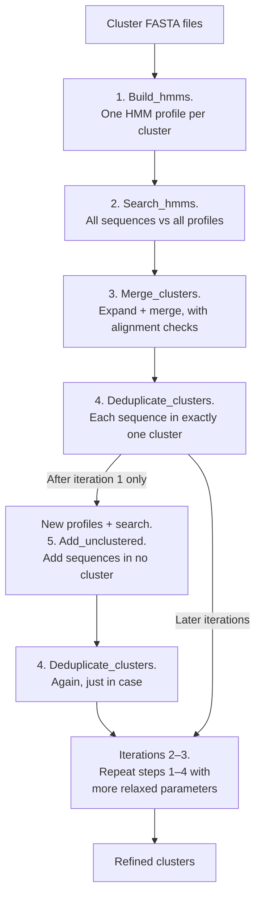

# cog-cluster-refiner

Merge over-split protein clusters (e.g. from the COG algorithm) into larger, coherent groups using
profile HMMs and alignment-based quality checks.

Clustering methods such as COG often split a single protein family into many small, very specific
clusters. This pipeline takes those clusters, builds a profile HMM for each one, finds clusters
that are really parts of the same family, and merges them — but only when alignments confirm that
the merge makes sense. The process is repeated for a few iterations.



## Requirements

* Python 3.9+ with `numpy` and `pandas` (developed and tested with Python 3.12, numpy 2.4 and pandas 3.0;
  the minimum versions in `requirements.txt` are lower bounds that have not been tested)
* [HMMER 3](http://hmmer.org/) (`hmmbuild`, `hmmsearch`)
* [Clustal Omega](http://www.clustal.org/omega/) (`clustalo`); [MAFFT](https://mafft.cbrc.jp/) is optional (step 1 only)

```bash
conda env create -f environment.yml     # installs everything
conda activate cog-cluster-refiner
```

or `pip install -r requirements.txt` plus `conda install -c bioconda hmmer clustalo`.

**Input:** a folder with one FASTA file per cluster (`.fasta`, `.fa` or `.faa`); the file name
(without extension) is the cluster ID. Sequences must be **proteins** with unique IDs
(the ID is the first word of the header).

## Quick start

```bash
python run_pipeline.py --input clusters/ --workdir results/ \
    --unclustered unclustered.fasta --iterations 3 --threads 8
```

`--unclustered` is optional: a FASTA file with sequences that are in no cluster yet. They are added
once, after the first iteration (step 5 below). The result is in `results/final_clusters/`. Every
iteration keeps its own folder, so you can look at every intermediate result:

```
results/
├── iter_1/
│   ├── alignments/   multiple sequence alignment of each cluster
│   ├── profiles/     one .hmm profile per cluster
│   ├── hits/         hmmsearch tables (CSV)
│   ├── merged/       clusters after step 3
│   ├── dedup/        clusters after step 4
│   ├── logs/         merge_decisions.csv, merge_history.json, dedup_report.tsv, ...
│   └── unclustered/  (only after the chosen iteration) the same layout for the step that adds
│                     unclustered sequences: added/ and dedup/ hold the enlarged clusters
├── iter_2/ ...       starts from the enlarged clusters
├── run_info.json     command line, schedule and program versions of this run
└── final_clusters/   copy of the last result
```

Each iteration builds new profiles from the clusters it starts with; this is needed because a
merged or enlarged cluster needs a profile that describes all of its members. Watch the cluster
counts printed at the end.

### Parameters that change from iteration to iteration

Later iterations should accept weaker evidence, so that more sequences can join a cluster. The
parameters of every iteration are stored in a schedule file; the default is
[`schedules/relaxing_3_iterations.json`](schedules/relaxing_3_iterations.json):

| step 3 option | iteration 1 | iteration 2 | iteration 3 |
|---|---|---|---|
| `--score-window` | 0.35 | 0.45 | 0.55 |
| `--min-overlap` | 0.12 | 0.10 | 0.08 |
| `--min-shared` | 1 | 2 | 2 |
| `--rep-sample-size` | 50 | 50 | 50 |
| `--pre-min-consensus` | 0.28 | 0.24 | 0.20 |
| `--expand-min-fit`, `--pre-min-fit` | 0.24 | 0.20 | 0.17 |
| `--pre-max-fit-diff` | 0.55 | 0.70 | 0.90 |
| `--post-max-bad-fraction` | 0.22 | 0.30 | 0.33 |
| `--post-member-fit` | 0.22 | 0.20 | 0.20 |

### Switching between schedules

The default schedule is `relaxing_3_iterations`. Choose another with `--schedule`:

```bash
python run_pipeline.py --list-schedules                                    # what is available
python run_pipeline.py --input clusters/ --schedule relaxing_3_iterations_any_two_shared
python run_pipeline.py --input clusters/ --schedule my_schedule.json       # a file of your own
python run_pipeline.py --input clusters/ --schedule none                   # script defaults in every iteration
```

Shipped schedules (folder `schedules/`) can be given by name, with or without `.json`; anything else is
taken as a file path.

* `relaxing_3_iterations` — the values in the table above.
* `relaxing_3_iterations_any_two_shared` — the same values, but a pair of clusters is tried as soon as it
  shares two sequences (`--min-overlap 0 --min-shared 2`) and the alignment checks decide.

To make your own schedule, copy one of these files, change the values and pass its path. Keys are the
option names with underscores (`"score_window": 0.45` means `--score-window 0.45`); each iteration can have
a `"merge"` and a `"dedup"` section, and `"add_unclustered"` holds the options of step 5. If you ask for more
iterations than the schedule defines, the last entry is reused. Extra options for every iteration can be
added with `--merge-args "..."`, `--dedup-args "..."` and `--add-args "..."`; they override the schedule.
The driver checks all options of all iterations before it starts, so a typo is reported immediately.

The schedule that was used is saved in `<workdir>/run_info.json`, together with the command line and the
versions of HMMER and Clustal Omega, so every result folder tells you how it was made.

**What every option means is described in [docs/PARAMETERS.md](docs/PARAMETERS.md)**, including a glossary
of the terms (fit, core column, coverage, ...) and the fixed constants of the method.

## The steps

You can also run the scripts one by one (`--help` lists every option).

### 1. `scripts/01_build_hmms.py` — profiles

```bash
python scripts/01_build_hmms.py --clusters clusters/ --profiles profiles/ --alignments alignments/
```

Aligns each cluster (Clustal Omega, or `--aligner mafft`) and runs `hmmbuild`. Clusters with a single
sequence are passed to `hmmbuild` directly.

### 2. `scripts/02_search_hmms.py` — sequences vs. profiles

```bash
cat clusters/*.fasta > all_sequences.fasta        # every sequence that is in a cluster
python scripts/02_search_hmms.py --profiles profiles/ --targets all_sequences.fasta --out hits/
```

Runs `hmmsearch` for each profile and writes one CSV per profile (columns: `query_profile`,
`target_seq`, `accession`, `evalue`, `score`, `bias`, `target_file`), best hit first. (`run_pipeline.py`
builds the target file for you and removes repeated sequence IDs.)

### 3. `scripts/03_merge_clusters.py` — expand and merge

```bash
python scripts/03_merge_clusters.py --clusters clusters/ --hits hits/ --out merged/ --log-dir logs/
```

Only sequences that already belong to a cluster are considered.

**A. Expansion.** For each cluster, take the median profile score of its own members. Sequences from
*other* clusters scoring within ±35 % of that median (`--score-window`) are candidates. A candidate joins only if it
fits the cluster in an alignment (see [How "fit" is measured](#how-fit-is-measured)). Afterwards the
same sequence may be in several clusters — clusters that are really one family now overlap.

**B. Merge candidates.** A pair of clusters is tried when they share enough sequences
(`overlap = shared / size of the smaller cluster ≥ 0.12`), or when they share 2+ sequences that both
profiles score in a strongly correlated way (the "score-signal path"). For this path the bit scores of
different profiles have to be made comparable: each profile's scores are divided by the best score
that profile gives to any member of its own cluster (1.0 = "as good as its best member"). Then two
conditions must hold: the shared sequences score on average at least 35 % (`--signal-min-mean-score`),
and at least one of them reaches 55 % (`--signal-min-max-score`).

**C. Validation.** Candidate pairs are tried best first:

* *pre-merge:* align representatives of both clusters; reject if the alignment is poorly conserved
  (`low_consensus`), if neither cluster fits the columns both clusters cover (`no_core_fit`), or if one
  fits much better than the other (`fit_diff_too_large`);
* *post-merge:* align the whole merged cluster; reject if more than 22 % of the members fit badly
  (`too_many_bad_members`).

A merge that passes both is accepted; the larger cluster keeps its name and absorbs the other one.

**D. Output.** Merged clusters plus logs. The script aborts instead of writing if any sequence
would be lost.

| log file | content |
|---|---|
| `merge_decisions.csv` | one row per pair tried: sizes, overlap, score correlation, alignment metrics, accept/reject and the reason |
| `merge_history.json` | parameters used, expansion statistics per cluster, list of accepted merges |
| `expanded_clusters.json` | members of every cluster after expansion (for tracing sequences) |

### 4. `scripts/04_deduplicate_clusters.py` — one cluster per sequence

```bash
python scripts/04_deduplicate_clusters.py --clusters merged/ --out dedup/ --log-dir logs/
```

For each sequence that is in several clusters, computes its fit to each of them and keeps it only
in the best one. The fit uses a random sample of at most 200 members per cluster; the sample is
reproducible (`--seed`). Duplicates are resolved in alphabetical order, and each removal is visible to
the next decision. `dedup_report.tsv` lists, for every duplicated sequence, where it was kept and the
fit in every cluster it was removed from.

### 5. `scripts/05_add_unclustered.py` — add sequences that are in no cluster

Done **once**, after the first iteration's deduplication. Build profiles of the *current* clusters and
search both the clustered and the unclustered sequences with them, then:

```bash
python scripts/01_build_hmms.py --clusters dedup/ --profiles profiles2/ --alignments alignments2/
cat dedup/*.fasta > clustered.fasta
python scripts/02_search_hmms.py --profiles profiles2/ --targets clustered.fasta unclustered.fasta --out hits2/
python scripts/05_add_unclustered.py --clusters dedup/ --unclustered unclustered.fasta \
    --hits hits2/ --out enlarged/ --log-dir logs/
python scripts/04_deduplicate_clusters.py --clusters enlarged/ --out enlarged_dedup/   # just in case
```

(`run_pipeline.py` does all of this for you.) The clustered sequences have to be searched as well,
because the script needs to know what a typical member scores. For each unclustered sequence:

1. Take the 3 clusters whose profile scores it best (`--top-n`);
2. The best score must be at least 1.35 times the second best (`--top-ratio`) — a clear winner;
3. In each of those clusters the sequence must pass the **score window** (its score is within ±30 %
   of the median member score; clusters with fewer than 6 scored members skip this) and the
   **alignment fit** (`--min-fit 0.30`);
4. The best-fitting cluster that passed is chosen;
5. **post-add check:** The cluster plus the new sequence are aligned; the sequence is added only if
   at most 22 % of the members fit badly.

Every sequence is judged against the clusters as they were before this step, so the order does not
matter. Sequences that fail simply stay unclustered; `add_unclustered_report.tsv` says why for each
one (`no_hmm_hits`, `failed_score_ratio`, `no_valid_cluster`, `failed_post_validation`), and
`unassigned.fasta` collects them.

## How "fit" is measured

Used when deciding whether a candidate joins a cluster (steps 3 and 5) and where a duplicate stays (step 4).

1. Align the sequence together with representative cluster members.
2. **raw fit** = fraction of its residues that equal the most common residue of their alignment column.
3. `normalized fit = raw fit × (0.5 + 0.5 × coverage) × (0.7 + 0.3 × length ratio) × size factor`
   * *coverage*: fraction of the cluster's **core columns** that the sequence spans. A column is a core
     column if fewer than 60 % of the representatives have a gap there — the same definition the
     pre-merge check uses (`--core-gap-tolerance`). A fragment covering 60 % of the family gets 0.6.
     (Counting *all* alignment columns instead would punish every sequence whenever a single
     representative carries a long insertion.)
   * *length ratio*: query length vs. mean length of the representatives (1 = same length).
   * *size factor*: `ln(cluster size + 1) / ln(50)`, at most 1. Clusters with fewer than ~50
     members are penalised on purpose, because the consensus of a tiny cluster is unreliable.
     In particular, **singletons and very small clusters rarely attract new sequences**.

## What to look at in the logs

* `merge_decisions.csv` — for every pair tried: `overlap`, `score_corr`, `mean_relative_score`,
  `max_relative_score`, the pre-merge fits, `pre_shared_reps` (how many of the representatives the two
  clusters have in common) and the reason for rejection. Use it to see which rule decides.
* The line `expansion totals: ...` printed by step 3 (and the per-cluster numbers in
  `merge_history.json`) shows how many candidates were rejected by the conservation test
  (`rejected_consensus`) and by the fit test (`rejected_fit`). A test that never rejects anything on
  your data does no work and can be switched off (`--expand-consensus-drop 0` also saves one alignment
  per candidate).

## Parameters

Every option has a default and a description: see [docs/PARAMETERS.md](docs/PARAMETERS.md) or run any
script with `--help`. The reference is generated from the scripts (`python tools/make_parameter_docs.py`),
so it always matches the code. Lower thresholds merge more aggressively; higher ones are more
conservative. `merge_decisions.csv` shows which rule rejects the pairs you expected to merge.

## Status and known limitations

* The pure-Python logic is covered by unit tests, and the whole pipeline has been run end to end on
  synthetic data. Please run it on a small subset of your own data first and inspect the logs.
* There is no resume function: if a run is interrupted, start again in a new `--workdir`.
* Everything runs sequentially (apart from the threads of HMMER and Clustal Omega), so large datasets take
  a long time; the many small alignments in steps 3 and 5 dominate the run time.
* The fit measure is the share of residues equal to the column consensus of a Clustal Omega alignment of
  a sample of the cluster. It is a pragmatic filter, not a statistical test, so thresholds are best chosen
  by looking at your own results.
* Proteins only (HMMER `hmmsearch`); there is no handling of nucleotide sequences.

## Good to know

* **Runtime** is dominated by Clustal Omega: expansion aligns every candidate separately, and the
  post-merge check aligns each complete merged cluster. `--expand-consensus-drop 0` skips one of the
  two alignments per candidate in the expansion (see the description of that option).
* The random sampling in step 4 is seeded (`--seed`). Other steps depend on the versions of
  Clustal Omega and HMMER you use, so note them when you report results.
* Output FASTA headers are `>sequence_id cluster_id`; the original header text is not kept.
* Residues are compared case-insensitively.
* **No input sequence is ever lost.** Every sequence of the input clusters stays in some cluster:
  steps 3, 4 and 5 each check this and abort before writing anything if it would be violated, and
  `run_pipeline.py` compares the final clusters with the input once more. Only unclustered sequences
  from step 5 can end up unassigned.

## Original scripts

The scripts the clusters were first produced with are kept in [`original_scripts/`](original_scripts/),
with only definite bug fixes applied (each marked with a `# FIX` comment) and nothing else changed. See
[original_scripts/README.md](original_scripts/README.md) for the order in which they were used and what was
fixed. They need Biopython, which the refactored pipeline does not.

## Differences from the original scripts

This version fixes several defects of the scripts the clusters were first produced with, some of which
change which clusters get merged. See [CHANGES_FROM_ORIGINAL.md](CHANGES_FROM_ORIGINAL.md).

## Tests

```bash
python -m unittest discover tests -v
```

The tests cover the pure-Python logic and do not need HMMER or Clustal Omega. They also check that
every option has a description and that `docs/PARAMETERS.md` is up to date.

## License

MIT License

Copyright (c) 2026 Mikhail Ivanov

Permission is hereby granted, free of charge, to any person obtaining a copy
of this software and associated documentation files (the "Software"), to deal
in the Software without restriction, including without limitation the rights
to use, copy, modify, merge, publish, distribute, sublicense, and/or sell
copies of the Software, and to permit persons to whom the Software is
furnished to do so, subject to the following conditions:

The above copyright notice and this permission notice shall be included in all
copies or substantial portions of the Software.

THE SOFTWARE IS PROVIDED "AS IS", WITHOUT WARRANTY OF ANY KIND, EXPRESS OR
IMPLIED, INCLUDING BUT NOT LIMITED TO THE WARRANTIES OF MERCHANTABILITY,
FITNESS FOR A PARTICULAR PURPOSE AND NONINFRINGEMENT. IN NO EVENT SHALL THE
AUTHORS OR COPYRIGHT HOLDERS BE LIABLE FOR ANY CLAIM, DAMAGES OR OTHER
LIABILITY, WHETHER IN AN ACTION OF CONTRACT, TORT OR OTHERWISE, ARISING FROM,
OUT OF OR IN CONNECTION WITH THE SOFTWARE OR THE USE OR OTHER DEALINGS IN THE
SOFTWARE.
